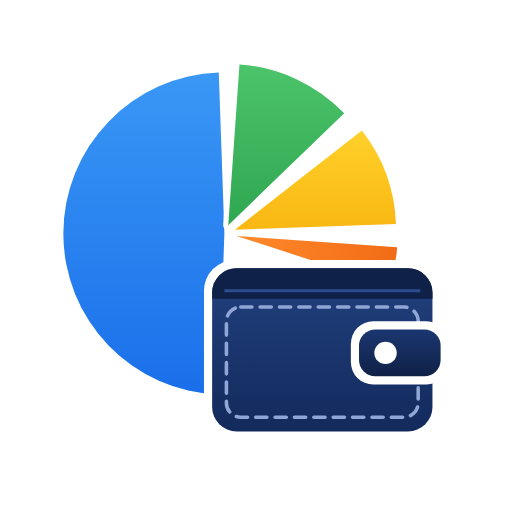

# Kharchnama for Android

**The logo:** a pie chart (where your money goes) resting on a wallet (what you keep).

Personal expense book with a speaking AI financial adviser: **HisaabJi** (5 male avatars) or **Finza** (5 female avatars), each with its own voice and about 40 body gestures. This is the Android build of the Kharchnama app.

## What the Android app adds
- **Voice entries**: say "spent 1,200 on petrol yesterday from cash" or "milk 500 and chicken 1500". The app fills the entry and you confirm before it is saved.
- **Talking adviser**: ask by voice; HisaabJi or Finza answers out loud and moves while speaking. The adviser greets you each time the app opens.
- **Bill scanning**: take a photo or upload a bill. On-device text reading (ML Kit) finds the total, date, merchant and items, suggests a head (or splits the bill by item), and nothing is added until you approve or change it.
- **Google sign-in** (optional, see below).
- **SMS auto-import**: reads bank and wallet transaction SMS. OTPs and promotions are ignored, duplicates are skipped, and you review before anything is added.
- **Bill reminders** as real notifications at 9:00 on the due date.
- **Fingerprint / face unlock** on top of the 4-digit PIN.
- **Reports and backups** save or share through Android's share sheet.
- **Works offline**: the adviser, voice, bill reading, fonts and libraries all run on the phone.

## Get the APK
Every push to `main` builds the app on GitHub Actions. Open the repository's **Releases** page on your phone, tap the latest `Kharchnama-N.apk`, and allow installing from your browser. New builds install over the old one and keep your data.

Web-only changes also arrive as in-app updates once GitHub Pages is on (Settings → Pages → Source: **GitHub Actions**).

## Turning on Google sign-in
1. In Google Cloud Console, create a project and configure the OAuth consent screen (External, add your Gmail as a test user).
2. Create an **Android** OAuth client: package `com.kharcha.app`, SHA-1 `6D:A4:DC:1B:B5:D8:0C:31:10:D4:BF:4B:3C:70:FF:5F:20:A9:7E:E7`.
3. Create a **Web application** OAuth client and copy its client ID.
4. In the app: profile button (top right) → Sign in with Google → paste the Web client ID.

## Build it yourself
1. Install Node 20, JDK 17 and Android Studio.
2. `npm ci && node build-web.js && npx cap sync android`
3. Open the `android` folder in Android Studio and press Run, or run `cd android && ./gradlew assembleDebug`.

## Project layout
- `web/app.html`: the app (same source as the Claude artifact version).
- `web/native.js`: bridge to Android features (voice, speech, camera, OCR, Google, SMS, updates).
- `android/app/src/main/java/com/kharcha/app/KharchaNativePlugin.java`: SMS, biometric unlock, bill OCR and Google sign-in.

## Before publishing on the Play Store
- Create a private release signing key; `kharcha-debug.keystore` is for personal testing only (and update the SHA-1 in Google Cloud).
- Google Play only allows SMS permissions for default SMS apps. For the store version, switch SMS import to bank-app notifications or remove it.
